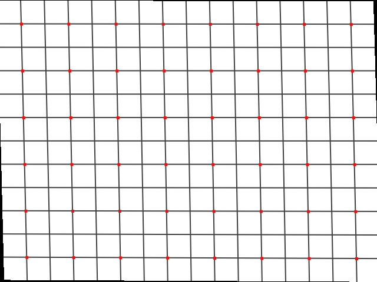
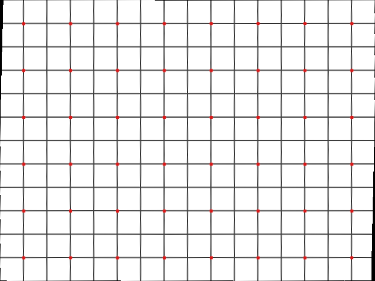
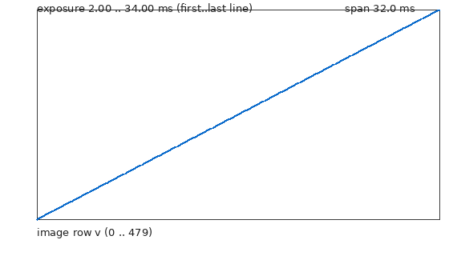
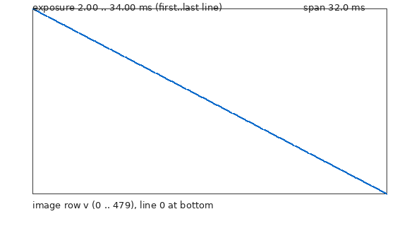

# 逐行曝光滚动快门校正器

按逐行曝光时刻求解每个输出像素的实际采样位置（逐像素逆映射，不是单一全局单应），
支持纯旋转与已知平面两种场景假设。无效区域（越界、姿态覆盖外、折叠、独立运动）
显式标记、留空，不做纹理补全。

## 入口

**图形界面（主入口）**：

```bash
python3 ui/server.py --port 8000   # 打开 http://127.0.0.1:8000/
```

界面含两个面板，共用同一条行曝校正处理链（`rs/pipeline.py:99` `run_photo` /
`rs/pipeline.py:136` `run_synthetic`）：

* **照片校正**：载入照片 + 参数 JSON + 姿态 JSON，滑块直接调整行时序
  （读出总时长 / 方向 / 时间偏移 / 参考时刻），实时显示真实校正影像、
  有效性掩码与映射误差（曝光时刻求解残差、有效比例、姿态检查结论）。
* **合成验证**：前向成像 + 校正的闭环验证，附控制点映射误差，可导出版本化结果。

**命令行（仅辅助）**：

```bash
python3 demo.py synth --scene grid --motion mixed        # 合成验证 + 导出
python3 demo.py photo --image in.png --params p.json --poses poses.json
```

## 约定

### 行时序（`rs/model.py` `ReadoutSpec`）

每条读出线上的所有像素共享同一曝光时刻。行号 0 的位置由 `direction` 决定：

| direction | 行号 0 位置 | 行号公式（像素 (u,v)） |
| --- | --- | --- |
| `top_to_bottom` | 图像顶行 (v=0) | r = v |
| `bottom_to_top` | 图像底行 (v=H−1) | r = (H−1) − v |
| `left_to_right` | 图像左列 (u=0) | r = u |
| `right_to_left` | 图像右列 (u=W−1) | r = (W−1) − u |

行 r 的曝光时刻（`rs/model.py:61` `line_time`）：

```
t(r) = t0_s + t_offset_s + r * readout_time_s / (n_lines − 1)
```

* `readout_time_s` 是**首行至末行的总时长**（不是每行耗时）；
* `n_lines` 竖向读出取图像高，横向读出取图像宽（`rs/model.py:44`）；
* `t0_s` 是假设两时钟一致时首行在姿态时钟上的时刻，`t_offset_s` 是
  传感器时钟相对姿态时钟的固定偏差。合成验证中真实偏移 2.0 ms
  （`rs/pipeline.py` `TRUE_OFFSET_S`），校正侧必须给到相同值才能对齐。

### 姿态轴向（`rs/poses.py`、`rs/lie.py`）

* 四元数顺序 **[x, y, z, w]**，含义为 **world→camera 旋转**（`cam = q ⊗ world`）；
* 角速度 `omega_rad_s` 在**机体（相机）系**，单位**弧度/秒**；
* 旋转矢量 = 轴 × 角，角一律**弧度**；所有报告（含 `adequacy` 的
  `max_step_rad`）与 `units` 声明一致，不使用度。

### 参考曝光（`t_ref_s`）

校正输出是 `t_ref_s` 时刻的全局快门图像：输出像素 (x,y) 的光线在参考时刻
确定，求解器反推它在输入图像中被哪一行、哪一时刻采到（`rs/corrector.py:55`
`build_inverse_map` 的不动点迭代）。`t_ref_s` 取曝光窗口中点时，输出帧对应
曝光正中间的瞬间，边缘区域需要的姿态外推最少。

### 单位

时间秒、角度弧度、长度米、焦距像素。参数文件中的 `units` 段只是声明，
读入代码不做换算——写入前请自行换算成上述单位。

## 参数逐项对照

下表把示例参数文件（`examples/sample_params.json`，由
`tools/make_calibration.py` 生成）的每个字段对应到实际读入代码：

| JSON 字段 | 读入代码 | 含义 / 单位 |
| --- | --- | --- |
| `camera.fx_px / fy_px` | `rs/pipeline.py:110` | 焦距，px |
| `camera.cx_px / cy_px` | `rs/pipeline.py:110` | 主点，px |
| `camera.width_px / height_px` | `rs/pipeline.py:111`（尺寸核对）、`:116` | 图像尺寸，px |
| `readout.readout_time_s` | `rs/pipeline.py:116` | 首行至末行总时长，s |
| `readout.direction` | `rs/pipeline.py:117` → `rs/model.py:51` | 见行时序表 |
| `readout.t0_s` | `rs/pipeline.py:117`（缺省 0） | 首行时刻（时钟无偏差时），s |
| `readout.t_offset_s` | `rs/pipeline.py:117`（缺省 0） | 传感器-姿态时钟偏差，s |
| `t_ref_s` | `rs/params.py:54`（缺失即拒绝）→ `rs/pipeline.py:118` | 参考曝光时刻，s |
| `scene.model` | `rs/pipeline.py:120` | `rotation` / `plane` |
| `scene.normal` / `dist_m` | `rs/pipeline.py:121-122` | 平面法向 / 距离，m |
| `scene.center0_m` / `velocity_m_s` | `rs/pipeline.py:122` | 参考时刻相机中心 / 线速度，m、m/s |
| `motion.*` | 仅记录，不参与校正 | 校正读取的是姿态文件 |
| 姿态文件 `times_s` + `quats_xyzw` | `rs/poses.py:27` `from_dict` | 显式时间戳 + 四元数 |
| 姿态文件 `gyro_times_s` + `gyro_rad_s` | `rs/poses.py:27` → `:57` | 陀螺积分，q0 可选 |

旧键名兼容：`t_ref`（无 `_s` 后缀）仍被读取（`rs/params.py:54`）；
平面场景旧键名 `dist` / `center0` / `velocity` **已失效**，请改用
`dist_m` / `center0_m` / `velocity_m_s`（`tools/check_params.py` 会报出）。

## 缺少时间参考的文件

* **参数文件缺 `t_ref_s`**：`rs/params.py` 直接拒绝并说明如何补写
  （例如取曝光窗口中点 `t0_s + t_offset_s + readout_time_s/2`）。
  校正器不会默默猜测一个让画面看起来平直的值——`t_ref_s` 决定输出帧
  代表运动中的哪一个瞬间，没有安全默认值。
* **姿态文件缺时间戳**（只有四元数或只有采样率）：`rs/poses.py:27`
  拒绝并要求显式时间基准，不按采样率猜时间轴。

## 限制与程序行为对照

以下每条限制都有对应程序行为，并由 `tools/build_examples.py` 的
`expect` 断言可执行核验（示例名见指标表）：

| 情形 | 程序行为 | 核验示例 |
| --- | --- | --- |
| 倒序读出（bottom_to_top / right_to_left） | 行号 0 在底边/右边，照常收敛 | `grid_reversed` |
| 零角速度 | 校正退化为恒等，不引入误差 | `grid_static` |
| 采样范围不够（姿态轨迹不覆盖曝光窗口） | 窗口外像素标记 `pose_coverage`（橙色），姿态报告拒绝，绝不外推 | `tests/test_rs.py::test_pose_coverage_gap_flagged_per_row` |
| 采样过疏（相邻姿态转角 > 2°） | 姿态报告 `sparse` 拒绝 | `grid_sparse` |
| 剧烈运动导致映射折叠 | 折叠区域标记 `folding`（青色），越界标记 `out_of_bounds`（红色） | `grid_extreme` |
| 独立运动物体 | 超出模型假设，仅按掩码标记 `independent_motion`（黄色） | `demo.py synth --moving` |
| 求解不收敛 | 报告 `not_converged`，相关区域按无效标记 | `grid_extreme` |
| 单一全局单应 | 不够：统计中给出 `mae_global_homography` 基线供对比 | 各示例 stats |

## 维护工具（可执行核验入口）

```bash
python3 tools/make_calibration.py --out examples   # 生成标定图片与样例
python3 tools/check_params.py examples/sample_params.json --poses examples/sample_poses.json
python3 tools/check_params.py --manifest out/manifest.json   # 查已失效参数/资源引用
python3 tools/build_examples.py                    # 干净目录重建全套示例 + 文档指标
```

* `tools/make_calibration.py`：生成标定图案（网格控制点、竖线）、一张合成
  滚动快门“样片”及配套参数/姿态文件（`examples/`，随仓库提交），可直接
  喂给图形界面或 `demo.py photo`。
* `tools/check_params.py`：逐项校验参数组合（必填字段、单位、方向枚举、
  平面键名、姿态覆盖），`--manifest` 模式核对导出清单中每个文件存在且
  参数内容哈希与文件名版本标签一致。
* `tools/build_examples.py`：**交付核验入口**。清空输出目录（不带旧缓存）
  重建全套示例，从导出的 `.npz` 映射重新计算控制点误差，把指标表注入本
  文件（下方标记之间），并复核 manifest；任一 `expect` 断言失败即非零退出。

测试：`python3 -m unittest discover -s tests`

## 指标与示意图

文档中的控制点误差由 `tools/build_examples.py` **读取导出的输出映射**
（`out/*_map_*.npz`，含真值前向映射 `fmap_uv`）做往返闭环计算，不是手工
填写的数字；示意图（`docs/figures/`）同样从真实导出结果生成，包括各示例的
输入/校正/有效性图与行时序图（直接用导出的 `row_times_s` 绘制）。

<!-- METRICS:BEGIN -->
（本表由 `tools/build_examples.py` 读取导出映射重新计算，请勿手改）
| 示例 | 说明 | 版本 | 控制点均值 (px) | 控制点最大 (px) | 平坦区 MAE | 有效比例 | 姿态检查 |
| --- | --- | --- | --- | --- | --- | --- | --- |
| `grid_mixed` | 默认情形：混合角速度，自上而下读出 | `6f3b42d64b83` | 2.168e-06 | 6.261e-06 | 0.000216 | 0.995 | 通过 |
| `grid_reversed` | 倒序读出：行号 0 在图像底边 | `70abb31edb23` | 2.563e-06 | 7.118e-06 | 0.0002175 | 0.987 | 通过 |
| `grid_static` | 零角速度：校正必须退化为恒等 | `012a20df15da` | 0 | 0 | 0 | 1.000 | 通过 |
| `lines_yaw` | 竖线场景：偏航导致的倾斜应被拉直 | `686528bc693e` | 1.557e-06 | 4.703e-06 | 0.0001762 | 0.992 | 通过 |
| `plane_mixed` | 已知平面 + 平移：旋转模型不够，需平面模型 | `c1da0b6eb029` | 2.412e-06 | 5.924e-06 | 0.0002196 | 0.996 | 通过 |
| `grid_extreme` | 剧烈运动：映射折叠与越界区域必须被标记 | `6a24f4129ca9` | 164 | 524.6 | 0.7545 | 0.205 | 拒绝 |
| `grid_sparse` | 采样过疏（相邻姿态转角超限）：姿态报告必须拒绝 | `c77f7a5ac33e` | 2.168e-06 | 6.261e-06 | 0.000216 | 0.995 | 拒绝 |
<!-- METRICS:END -->

### 默认示例（grid_mixed）

| 输入（滚动快门畸变） | 校正结果 | 有效性 |
| --- | --- | --- |
|  |  |  |

行时序（倒序读出对照）：

| top_to_bottom | bottom_to_top |
| --- | --- |
|  |  |

## 图形界面操作流程（照片校正）

1. `python3 ui/server.py --port 8000` 打开界面；
2. 在「照片校正」面板选择照片、参数 JSON、姿态 JSON
   （可先拿 `examples/sample_*` 试跑）；
3. 用滑块调整行时序：读出总时长、读出方向、时间偏移、参考时刻——
   控件直接绑定校正处理链，松开即重算；
4. 核对校正影像与映射误差：控制台上方的指标行给出曝光时刻求解残差、
   有效比例与姿态检查结论，详情 JSON 中有逐类无效原因计数；
   无效区域在有效性掩码中按颜色区分，不会被纹理补全掩盖。
